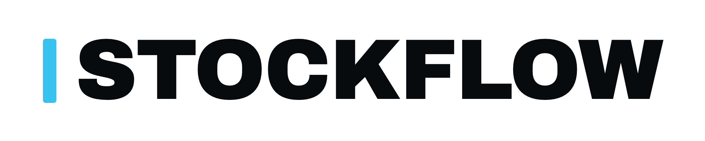

<p align="center">
  <picture>
    <source media="(prefers-color-scheme: dark)" srcset="docs/marca/stockflow-wordmark.png">
    
  </picture>
</p>

<p align="center">
  Multi-tenant stock management for restaurants, bakeries and cafés.<br>
  Django 5 · DRF · PostgreSQL with row-level security · React 18 · TypeScript
</p>

---

StockFlow answers the three questions a kitchen owner asks every morning — *what
is missing, what expires today, how much did I throw away* — and it answers them
from a **ledger**: stock levels are never edited, they are the sum of movements.
Goods come in from a supplier invoice, counts are taken standing in the
storeroom, and waste is recorded with a reason and an author.

It is built for a desktop in the back office, with the phone serving the two
field flows (counting and receiving) that genuinely happen on your feet.

## Status, honestly

This is an MVP under construction. The split below is the real one, not a
roadmap:

| Area | State |
|---|---|
| Authentication, invitations, activation links | **Built**, against the real backend |
| Multi-tenancy with per-tenant row-level security, three database roles | **Built** |
| Per-tenant menu projection, filtered by role | **Built** |
| Stock, alerts, receiving, invoice review, counting, management panel | **Screens built**, served by a fake-data server in development (ADR 0008) |
| The domain backend behind those screens | **Not written yet.** Only `accounts` and `shared` have tables |
| Supplier-invoice extraction via AI | **Planned.** The module boundary exists; the model does not |
| Three colour palettes — dark, graphite, light | **Built and measured** (ADR 0015) |
| Theme preference, settings screens, demo establishment | **Decided** (ADRs 0016–0018), not implemented |

The screens run on fake data **on purpose**: they are the instrument used to ask
a real owner the domain questions that decide the catalogue and the ledger, and
building the backend before those answers means building it twice.

## Running it

You need Docker, [uv](https://docs.astral.sh/uv/) and
[pnpm](https://pnpm.io/) (via corepack).

```bash
# the whole stack behind a reverse proxy, on :8090
docker compose --env-file backend/.env -f docker/compose.yml up --build

# or, for development: the backend on :8010 and the frontend on :5183
cd backend  && uv sync && uv run manage.py migrate && uv run manage.py runserver 8010
cd frontend && pnpm install && pnpm dev
```

`backend/.env.example` lists every variable. There are **no defaults for
secrets**: a missing `DJANGO_SECRET_KEY` or `DATABASE_URL` is a startup failure,
not a silent fallback.

## The gates

The interesting part of this repository is what it refuses to let you do. Every
one of these runs in CI and most of them exist because something broke once:

```bash
cd backend  && uv run ruff check . && uv run lint-imports && uv run pytest
cd frontend && pnpm typecheck && pnpm lint && pnpm build
bash .claude/skills/security-check/scripts/security_check.sh
```

- **`lint-imports`** — modules may only reach each other through `apps/<m>/api.py`.
- **`pytest`** — among 325 tests, one walks `pg_class` and fails in *both*
  directions if the closed list of tables without an RLS policy and the database
  disagree.
- **`pnpm lint`** — beyond ESLint, three gates measure the design system: sRGB
  gamut at 1e-6 and WCAG contrast for **each** palette against that palette's
  worst surface (computed, not named); that no file in `src/` imports the
  fake-data server; and that every `data-*` variant in use is declared.
- **CI also scans the built artefact** for sentinels, so fake data and
  development-only screens cannot reach production unnoticed.

## Reading the code

| File | What it holds |
|---|---|
| `CLAUDE.md` | The rules that win over any instinct, and who does what |
| `ARCHITECTURE.md` | Modules, flows, boundaries |
| `DESIGN.md` | The visual system — identity, tokens, components, layout |
| `SECURITY.md` | Threat model, settings, encryption, CI |
| `docs/decisions/` | 18 ADRs. Each one says what was decided **and what it cost** |
| `docs/kickoff.md` | How the repository started. Historical |

**The code, the comments and the commit messages are in European Portuguese**,
and deliberately so: the product is for Portuguese kitchens, the domain
vocabulary is Portuguese (*consumir até* is not *best before*), and a codebase
that names its domain in a second language loses the distinction that matters.
The documents above are the same. This README is in English because the
repository is public-facing.

## A note on how this was built

Most of this repository was written by Claude Code, with the decisions — product
direction, visual identity, scope — made by its owner. The ADRs in
`docs/decisions/` and the commit messages are the record: they say what was
measured, and they say where an assumption turned out to be wrong.
